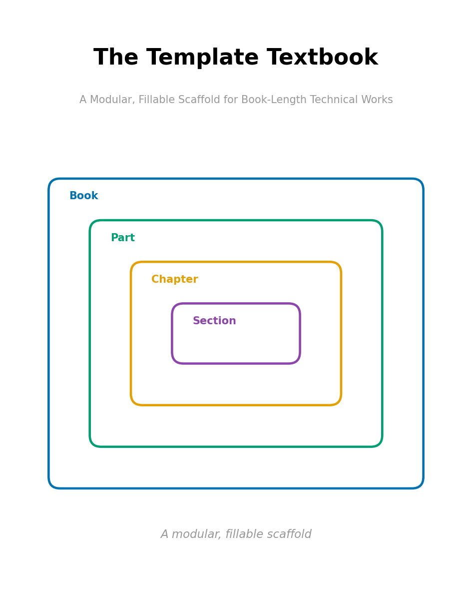

# The Template Textbook — Modular, Fillable Book Scaffold

A domain-neutral exemplar that demonstrates the **book-length manuscript** shape
for this research-template monorepo: a data-driven manuscript (parts → chapters →
labs → question banks), a tested computational backbone under `src/`,
deterministic figure and diagram generators, and a content scaffold/validation
engine that lets a future author fill marked stubs out to hundreds or thousands
of pages without drifting from the structural contract.



Everything downstream — the table of contents, chapter auto-numbering, figure
generation, lab/question wiring, and the manuscript-integrity tests — reads a
single source of truth: [`manuscript/config.yaml`](manuscript/config.yaml). To
grow the book you edit that file, then run a thin orchestrator that materialises
the missing stub files in the correct shape.

The config boundary is validated before filesystem work begins. `units:` wins
over the legacy `parts:` alias even when explicitly empty; part directories and
chapter/intro filenames must be relative, portable, single-level Markdown paths;
path traversal, absolute paths, malformed entries, and duplicate source paths
fail the gate rather than being interpreted by a scaffold or renderer.

## When to use this template

Use this template for **book-length manuscripts**: parts → chapters → labs →
question banks declared in a single `config.yaml`, with auto-numbering,
deterministic figure/diagram generation, and structural-contract tests that
keep hundreds of pages from drifting. For a single-paper computational
project see
[`template_code_project`](https://github.com/docxology/template/tree/main/projects/templates/template_code_project);
for editorial/prose review see
[`template_prose_project`](https://github.com/docxology/template/tree/main/projects/templates/template_prose_project).
Full roster:
[`projects/AGENTS.md`](https://github.com/docxology/template/blob/main/projects/AGENTS.md#permanent-canonical-exemplars).

## Publication and rendering

The publishing metadata and per-platform status below are **compiled from
`manuscript/config.yaml`** by `infrastructure.publishing.status_report` — do not
hand-edit between the markers; update the config and regenerate (see the legend).

<!-- PUBLISHING-STATUS:START (generated by infrastructure.publishing.status_report) -->
**template_textbook** · Daniel Ari Friedman

Concept DOI: [10.5281/zenodo.20533125](https://doi.org/10.5281/zenodo.20533125) | Version DOI: [10.5281/zenodo.20932112](https://zenodo.org/records/20932112) | Repository: [docxology/template_textbook](https://github.com/docxology/template_textbook)

Publishing surface — 20 platforms, 9 published:

| Platform | Tier | Status | Reference | Credentials |
| --- | --- | --- | --- | --- |
| zenodo | first-class | ✅ published | [10.5281/zenodo.20533125](https://doi.org/10.5281/zenodo.20533125) | `ZENODO_API_TOKEN` |
| github | first-class | ✅ published | [docxology/template_textbook](https://github.com/docxology/template_textbook) | `GITHUB_TOKEN` |
| arxiv | first-class | ⚪ available | — | — |
| pypi | first-class | ✅ published | [https://test.pypi.org/project/template-textbook/0.1.2/](https://test.pypi.org/project/template-textbook/0.1.2/) | `PYPI_TOKEN`, `TESTPYPI_TOKEN` |
| ipfs_pinata | first-class | ✅ published | [https://gateway.pinata.cloud/ipfs/QmaTFtcxkdPJGC3HHWVCkQQC81SYTD8Ninu2BB9KxiHxEN](https://gateway.pinata.cloud/ipfs/QmaTFtcxkdPJGC3HHWVCkQQC81SYTD8Ninu2BB9KxiHxEN) | `PINATA_JWT` |
| ipfs_web3storage | first-class | ⚪ available | — | `WEB3_STORAGE_TOKEN` |
| software_heritage | first-class | ✅ published | [https://archive.softwareheritage.org/browse/origin/?origin_url=https://github.com/docxology/template_textbook](https://archive.softwareheritage.org/browse/origin/?origin_url=https://github.com/docxology/template_textbook) | — |
| github_pages | first-class | ✅ published | [https://docxology.github.io/template_textbook/](https://docxology.github.io/template_textbook/) | `GITHUB_TOKEN` |
| cloudflare_pages | first-class | ⚪ available | — | `CLOUDFLARE_API_TOKEN` |
| netlify | first-class | ✅ published | [https://6a4443ae4a7a3eb5dba63532--tranquil-kleicha-0c9203.netlify.app](https://6a4443ae4a7a3eb5dba63532--tranquil-kleicha-0c9203.netlify.app) | `NETLIFY_AUTH_TOKEN` |
| huggingface_hub | first-class | ✅ published | [https://huggingface.co/datasets/ActiveInference/template_textbook](https://huggingface.co/datasets/ActiveInference/template_textbook) | `HUGGINGFACE_TOKEN`, `HF_TOKEN` |
| osf | first-class | ✅ published | [https://osf.io/8kg5z/](https://osf.io/8kg5z/) | `OSF_TOKEN` |
| amazon_kdp | documented | 🟡 planned | — | `AMAZON_KDP_EMAIL`, `AMAZON_KDP_PASSWORD` |
| google_play_books | documented | 🟡 planned | — | `GOOGLE_PLAY_BOOKS_SERVICE_ACCOUNT_JSON` |
| gumroad | documented | 🟡 planned | — | `GUMROAD_ACCESS_TOKEN` |
| leanpub | documented | 🟡 planned | — | `LEANPUB_API_KEY` |
| lulu | documented | 🟡 planned | — | `LULU_CLIENT_KEY`, `LULU_CLIENT_SECRET` |
| draft2digital | documented | 🟡 planned | — | `DRAFT2DIGITAL_API_TOKEN` |
| stripe | documented | 🟡 planned | — | `STRIPE_SECRET_KEY`, `STRIPE_PUBLISHABLE_KEY` |
| ingramspark | documented | 🟡 planned | — | `INGRAMSPARK_CLIENT_ID`, `INGRAMSPARK_CLIENT_SECRET` |

_Status legend: ✅ published (durable identifier recorded in `config.yaml`) · 🔵 reserved (identifier reserved but not yet registered by final publication) · ⚪ available (adapter implemented and locally verifiable) · 🟡 planned. This block is generated — edit `manuscript/config.yaml`, then regenerate with `uv run python -m infrastructure.publishing.status_report --project <path> --write`._
<!-- PUBLISHING-STATUS:END -->

The 3 platforms still shown ⚪ available are not automatable to "published" with
current tooling/credentials, not an oversight: **arXiv** has no submission API
in this codebase (`infrastructure.publishing.arxiv` only prepares a local
tarball — a human must upload it via arxiv.org and the resulting `arxiv` URL
would then be added to `publication.published_artifacts`); **Cloudflare
Pages** needs a `CLOUDFLARE_ACCOUNT_ID` the configured API token cannot
auto-discover; **IPFS (Web3.Storage)** has no `WEB3_STORAGE_TOKEN` configured.

- Canonical renderer: [docxology/template](https://github.com/docxology/template) with `--project templates/template_textbook`
- Tracked outputs: [`output/`](output/) in this project and `output/templates/template_textbook/` in the monorepo; public output files above 50 MB stay out of git.

To regenerate this exemplar from the public monorepo:

```bash
git clone https://github.com/docxology/template
cd template
uv sync
./run.sh --project templates/template_textbook --pipeline --core-only
uv run python scripts/pipeline/stage_04_validate.py --project templates/template_textbook
uv run python scripts/pipeline/stage_05_copy.py --project templates/template_textbook
```

Standalone repositories are publication mirrors for source, DOI metadata, and
tracked rendered artifacts. Use the monorepo above when you need the full shared
infrastructure, pipeline stages, or cross-template validation.

## What this template is

- **Modular.** Structure is declared in YAML, not hand-numbered. Add a part or a
  chapter in `config.yaml` and the numbering, TOC labels, lab, and question bank
  all follow.
- **Fillable.** Every generated chapter ships as a structurally-complete stub:
  labelled headings, a figure with alt text, a Study Blueprint, Learning
  Objectives, a worked formalism (equation + parameter table), an inline Mermaid
  diagram, and Summary / Key Terms / Further Reading / Practice sections. An
  author fills the prose between the markers.
- **Reproducible.** Figures and diagrams come from deterministic Python (fixed
  seeds, headless matplotlib). The same inputs always produce the same outputs.
- **Tested.** The computational backbone and the structural contract are both
  enforced by a no-mocks test suite at ≥90% coverage.

## Directory map

```
template_textbook/
├── manuscript/
│   ├── config.yaml            # SINGLE SOURCE OF TRUTH (parts → chapters)
│   ├── references.bib         # citation keys ([@key] must resolve here)
│   ├── glossary.md            # glossary anchors ([**term**](#gl:anchor))
│   ├── part_0/ … part_III/    # one .md per chapter; parts & chapters declared in config.yaml
│   ├── labs/<part>/           # one lab per chapter (lab_<stem>.md)
│   ├── questions/<part>/      # one question bank per chapter (q_<stem>.md)
│   ├── appendices/            # reference appendices
│   └── assets/                # cover and static assets
├── src/
│   ├── textbook/              # config, toc, content engine, constants, models
│   ├── visualization/         # deterministic matplotlib figures
│   ├── mermaid/               # Mermaid sources (PNG or .mmd fallback)
│   └── textbook_*.py          # paths, io, logging, visuals utilities
├── scripts/                   # thin orchestrators (figures, diagrams, analysis, scaffold, audit)
├── tests/                     # no-mocks suite incl. test_manuscript_integrity.py
└── pyproject.toml             # project config (90% coverage gate)
```

The four parts are: **Part 0** Orientation and Methods, **Part I** Fundamentals,
**Part II** Core Systems, **Part III** Applications and Synthesis — twelve
chapters in all.

## Quick start

All commands assume `uv` (never `pip`/`npm`) and run from the project
directory — this repository root. Inside the monorepo the same commands run
from `projects/templates/template_textbook/`, with the repo-root paths shown in
the [monorepo README](https://github.com/docxology/template/blob/main/README.md).

```bash
# 1. Install dependencies (base deps plus the `dev` extra: pytest, pytest-cov)
uv sync --extra dev

# 2. Materialise any missing stub files declared in config.yaml
uv run python scripts/scaffold_chapter.py

# 3. Generate deterministic figures and diagrams
uv run python scripts/generate_figures.py
uv run python scripts/generate_diagrams.py

# 4. Run the test suite with coverage (must collect >0 tests, ≥90% coverage)
uv run --extra dev python -m pytest tests/ --cov=src --cov-fail-under=90

# 5. Audit scaffold structure (default mode reports but allows stub markers)
uv run python scripts/audit_textbook_quality.py

# Before calling a filled fork complete, require zero stubs in audited sections
uv run python scripts/audit_textbook_quality.py --require-complete
```

> Two suite modules (`test_manuscript_integrity.py`, `test_visualization.py`)
> import the monorepo-only `infrastructure.validation.content` package, so they
> cannot be collected in a standalone mirror. Run the suite from a
> `docxology/template` checkout for the full set, or add
> `--ignore=tests/test_manuscript_integrity.py --ignore=tests/test_visualization.py`
> to run the standalone remainder. The 90% coverage floor is calibrated for the
> full monorepo suite, which those two modules help cover.

> Exit code 0 alone is not proof: confirm the suite collected more than zero
> tests and that coverage met the floor. The default audit proves scaffold
> structure; `--require-complete` is the explicit filled-manuscript gate.

## How to grow the book

The workflow is always **edit config, then scaffold**:

1. Open [`manuscript/config.yaml`](manuscript/config.yaml) and add a chapter under
   the relevant part (a `file:` + `title:` entry), or add a whole new part with
   its `id`, `title`, `label`, `directory`, and `chapters`.
2. Run `scripts/scaffold_chapter.py`. It reads the config and writes any missing
   chapter, lab, and question-bank stub in the contract-compliant shape. Existing
   files are left untouched.
3. Fill the prose between the stub markers (`<!-- STUB -->`, `TODO:`, `TKTK`).
   Keep the labelled heXY[™ÜËHšYİ\™KÙ\]X][Û‹İX›HÜ›ÜÜË\™Y™\™[˜Ù\Ë[™Bˆİ\œšXİ[[HØØY™›Û[�Xİ‚�ˆ™YÙ[™\˜]HšYİ\™\ËÙXYܘ[\ÈYˆ[İHYY™]ÈÛ™\Ë[ˆ�[ˆH\İÈ[™Bˆİ�Xİ\˜[]Y]ˆÛ˜ÙH]™\�H]Y]YÙXİ[Ûˆ\Èš[Y[ÛÈ�[ˆH]Y]ˆÚ]K\™\]Z\™KXÛÛ\]XÈ]™\Ü�ÈXXÚÙXİ[Û‰ÜÈİXˆÛİ[�[™˜Z[ˆ[�[Hİ[™XXÚ\È™\›Ë‚‚�™XØ]\ÙHİ�Xİ\™H\ÈXÛ\™YÛ˜ÙH[ˆPSSH›ÛÚÈØ[ˆØØ[Hœ›ÛH\ÈL‹XÚ\\‚œÚÙ[]ÛˆÈ[ˆ\˜š]˜\š[H\™ÙHÛÜšÈÚ]İ]™[�[X™\š[™È[�][™È�H[™‚‚ˆÈÈH\ÚYÛˆ[ˆÛ™H\˜Yܘ\‚˜ÛÛ™šYË�X[[XÛ\™\ÈHİ�Xİ\™KˆܘËİ^›ÛÚËØ\›œÈ]XÛ\˜][Ûˆ[�›�[X™\š[™È
ØËœX
K˜[Y][Ûˆ[™ØØY™›Û[™È
ÛÛ�[�œX
KHİ�Xİ\˜[˜ÛÛ�˜Xİ
ÛÛœİ[�ËœX
K[™ÛÜšÙY›Ü›X[\Û\È
[Ù[ËœX
KˆØÜš\ËØ\™BŠŠ�[ˆܘÚ\ݘ]ܜʊ�ˆ^H[\Ü�\İYY]ÙÈœ›ÛHܘËØ[™HKÓÈ[™�š\İX[^˜][Û‹[™™]™\ˆ[\[Y[��\Ú[™\ÜÈÙÚXÈ[\Ù[™\ˈ\İËØ[™›Ü˜ÙB˜›İHX][™HX[�\ØÜš\ÛÛ�˜XİÚ]™X[]H[™›È[ØÚÜË‚‚ˆÈÈØİ[Y[�][ÛˆX\‚ŸØİ[Y[�™XY]›ÜˆŸKKHKKHŸ
Š•\Èš[H
‘PQQK›Y
JŠˆİ™\�šY]Ë\™XİÜ�HX\]ZXÚË\İ\�ÛÛ[X[™ËİÈÈÜ›İÈH›ÛÚÈŸØQÑS•Ë›YJQÑS•Ë›Y
HYÙ[�Y˜XÚ[™È™Y™\™[˜ÙNˆ[�˜\šX[�ËY][™ÈÚXÚÛ\İœ›Ş™[ˆœËˆš[X›Hš[\ÈŸØX[�\ØÜš\ØÛÛ™šYË�X[[JX[�\ØÜš\ØÛÛ™šYË�X[[
HHÚ[™ÛHÛİ\˜ÙHÙˆ�]›Üˆ›ÛÚÈİ�Xİ\™HŸ[ۛܙ\ÈØ‘PQQK›YJ΋ËÙÚ]X‹˜ÛÛKÙØŞÛÙŞKİ[\]K؛؋ÛXZ[‹Ô‘PQQK›Y
HÈØÓUQK›YJ΋ËÙÚ]X‹˜ÛÛKÙØŞÛÙŞKİ[\]K؛؋ÛXZ[‹ĞÓUQK›Y
HÈØQÑS•Ë›YJ΋ËÙÚ]X‹˜ÛÛKÙØŞÛÙŞKİ[\]K؛؋ÛXZ[‹ĞQÑS•Ë›Y
H\[[™HÙ[X[�XÜËÒH\š]KÛË[^Y\ˆ\˜Ú]Xİ\™H‚ˆÈÈÛÜšÙY^[\\œÈœËˆİXœÂ‚•ÛÈÚ\\œÈ\™Hš[YÈÛÛ\][Ûˆ\È
Š™š[š\ÚY\›ÜÙH™Y™\™[˜Ù\ÊŠˆ8 %ÛÜB�Z\ˆÚ\HÚ[ˆš[[™ÈH™\İ‚‚‹HØX[�\ØÜš\Ü\�ÒKÙš\œİÜš[˜Ú\\Ë›YJX[�\ØÜš\Ü\�ÒKÙš\œİÜš[˜Ú\\Ë›Y
H8 %H
›[Ù[Y\š]˜][ÛŠˆÚ\\ˆ
ÙÚ\İXÈÜ›İİÛÜšÙY�[X™\œÈœ›ÛH^›ÛÚË›[Ù[Ø
K‚‹HØX[�\ØÜš\Ü\�ÒRRKØØ\ÙWÜİYY\Ë›YJX[�\ØÜš\Ü\�ÒRRKØØ\ÙWÜİYY\Ë›Y
H8 %H
™]KYš]™[ˆØ\ÙHİYJˆ
Ü›İ\[™ËHš][™Û™\İ[Z]ÊK‚‚‘]™\�Hİ\ˆÚ\\ˆÚ\È\ÈHİ�Xİ\˜[KXÛÛ\]H
ŠœİXŠŠˆ
X\šÙYÚ]˜KKHÕPˆˆKO˜ÈÑΘ
KˆH\[™XÙ\–Ø\[™^ٛܛX]ÙØ[\�K›YJX[�\ØÜš\Ø\[™XÙ\ËØ\[™^ٛܛX]ÙØ[\�K›Y
B˜[™Ø\[™^ٛܛX[\Û\Ë›YJX[�\ØÜš\Ø\[™XÙ\ËØ\[™^ٛܛX[\Û\Ë›Y
B™[[ۜݘ]H]™\�HÛÛ�[�š[Z]]™H[™]™\�H›Ü›X[[[Y[�‚‚ˆÈÈİ]]›Ü›X]‚•H›ÛÚÈ™[™\œÈÈ
Š”‹STP‹[™ĞÖ
Šˆ
™[™\‹™›Ü›X]Ø[‚˜ÛÛ™šYË�X[[
KˆXYܘ[\È[X™Y\È[XYÙ\ÈÚ[ˆHÚ›ÛYHš[˜\�H\È™XXÚX›H�B˜Ø
ÙYHØØÜËİš\İX[^˜][Û—ÙİZYK›YJØÜËİš\İX[^˜][Û—ÙİZYK›Y
JK‚‚ˆÈÈXÙ[œÙB‚‘X[[XÙ[œÙYˆ
Š˜ÛÙJŠˆ
ܘËØØÜš\ËØ\İËØ
H[™\ˆ
Š�\XÚKL‹Œ
Š‚ŠØPÑS”ÑXJPÑS”ÑJJNÈ
Š›X[�\ØÜš\ÛÛ�[�
Šˆ
X[�\ØÜš\Ø
H[™\‚ŠŠ�ĞÈ–H
Œ
Šˆ
ØPÑS”ÑKPÓÓ•S•›YJPÑS”ÑKPÓÓ•S•›Y
JKˆÙYH[Û–ØÒS‘ÑSÑË›YJÒS‘ÑSÑË›Y
K‚‚ˆÈÈ[\]H[�YÜš]B‚‹H›Ü�Ø\™˜XÚÛÙΈØÑË›YJÑË›Y
K‚‹HÛÜKX[™Xİ\İÛZ^™HÛÛ™šYΈØX[�\ØÜš\ØÛÛ™šYË�X[[™^[\XJX[�\ØÜš\ØÛÛ™šYË�X[[™^[\JK‚‹H›Ú™Xݘ[Y][Û�ˆ]ˆ�[ˆKY^˜H]ˆ]Ûˆ[H]\İ\İËÈKXÛİ�\ܘÈKXÛİ‹Y˜Z[][™\�NL‚‹H™\ÈšY�˜[Y][Ûˆ
[ۛܙ\ÈÛ›JNˆ]ˆ�[ˆ]ÛˆØÜš\ËØ]Y]ØÚXÚ×İ[\]WÙšY�œHK\İšXİœ›ÛHHØŞÛÙŞKİ[\]XÚXÚÛİ]‚‚�KKH›Ø[K[Üœ[‹[˜]�œİ\�
[™[XZ[�Z[™Yˆ[šÜÈİX‹YØÜÈÛÈ^H\™H™XXÚX›NÈ›ÈÙ[™\˜]܈™Yœ™\Ú\È܈˜[Y]\È\È›ØÚÊHKO‚‚ˆÈÈ\™XİÜ�H	ˆİX‹YØİ[Y[�X\‚“˜]šYØ][Ûˆ[šÜÈÈ[‹]™YHØİ[Y[�È
ÙY\È[H\ØÛİ™\˜X›JN‚‚‹HÜܘËÈ8 %YÙ[�›İ\×JܘËĞQÑS•Ë›Y
B‚�KKH›Ø[K[Üœ[‹[˜]�™[™KO‚